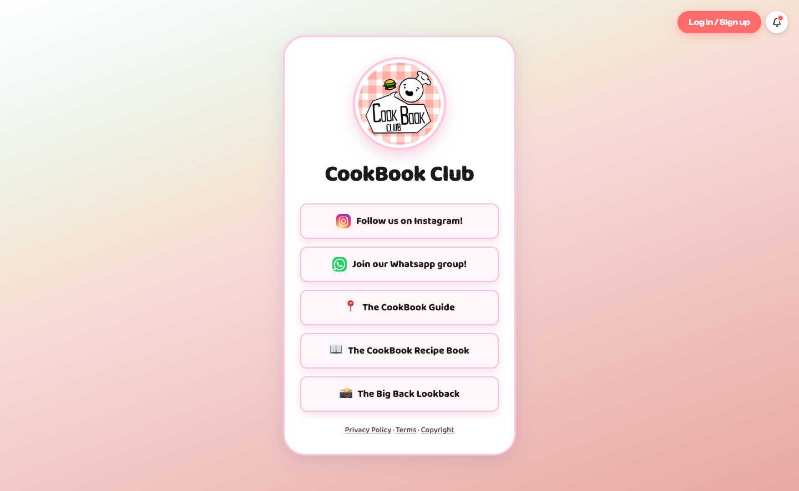
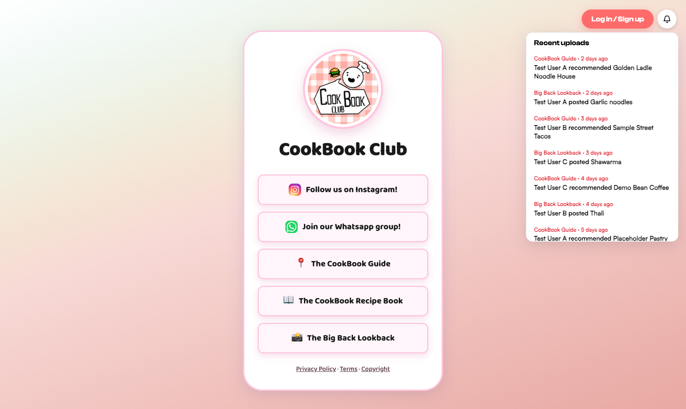
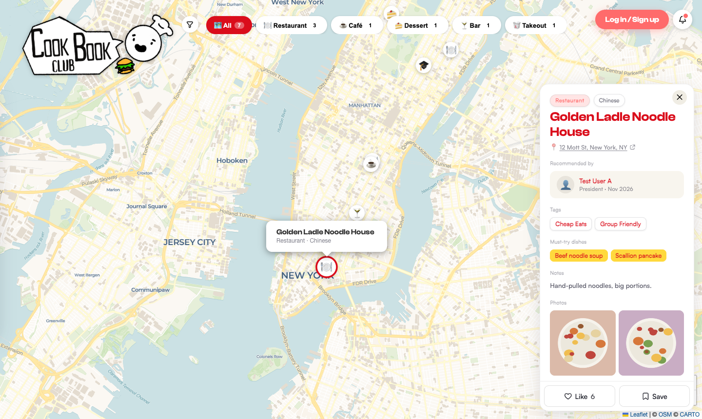
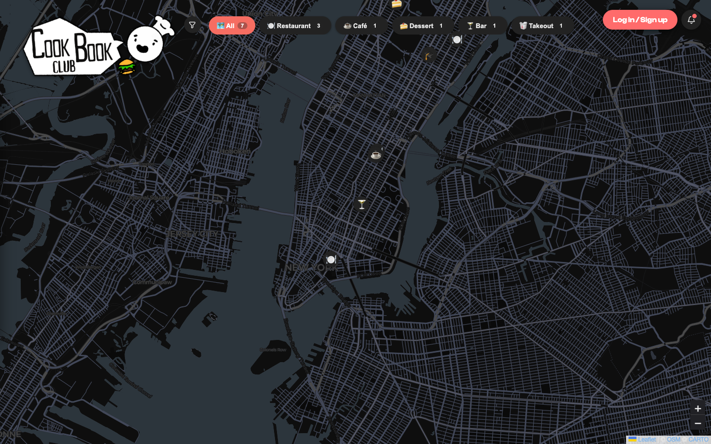
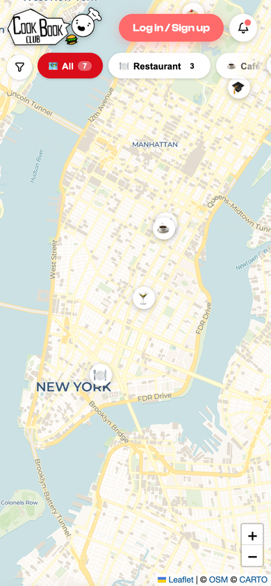
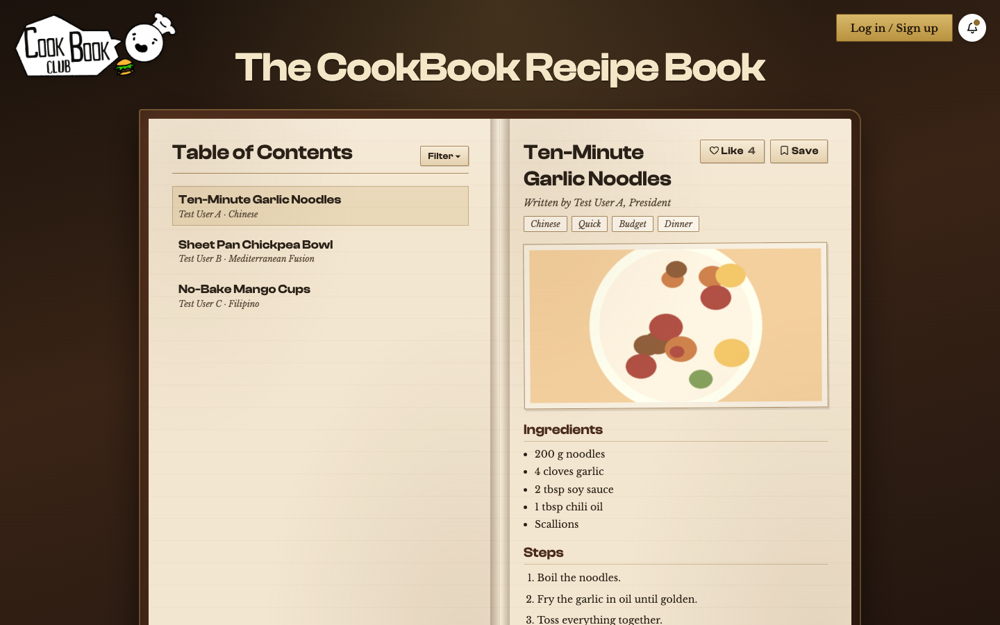
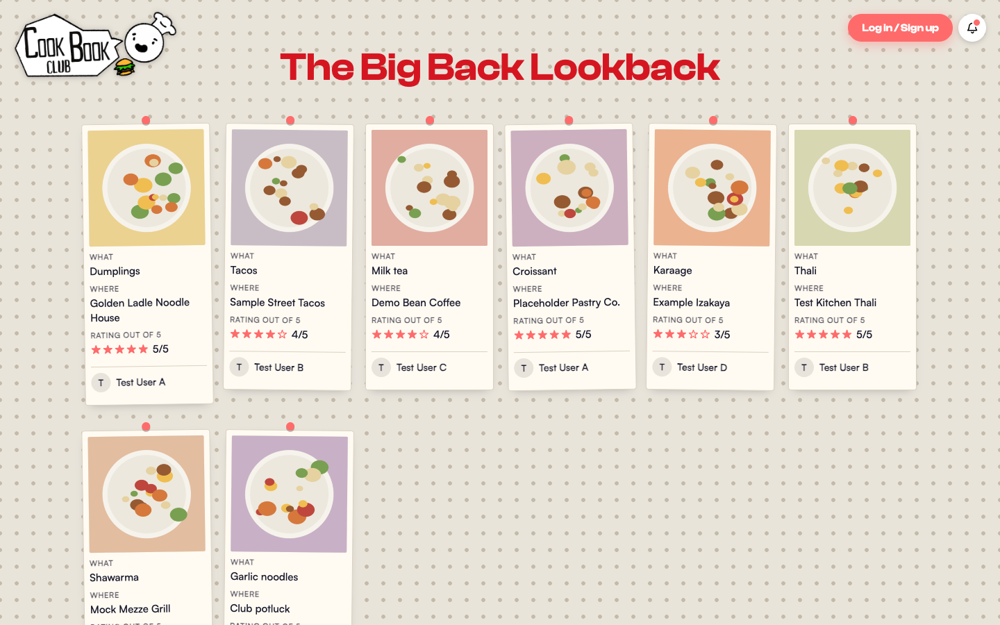

# CookBook Club

The website for CookBook Club, a food club. It has three tools: a map of restaurants members recommend, a shared recipe book, and a photo board of meals the club has eaten together.

Live at [cookbookclub.nyc](https://cookbookclub.nyc) (mirror: [hc-cookbookclub.vercel.app](https://hc-cookbookclub.vercel.app)).

Anyone can browse. Anyone with an account can add places, recipes and photos, and can edit or delete their own posts. E-board accounts can edit or remove any post.

> All screenshots use made-up test data (Test User A, Golden Ladle Noodle House, and so on). Photos are generated placeholders.



## Pages

### Landing (`/`)

Links to Instagram, the WhatsApp group and the three pages below. Like every page, it has the club logo (links back home), the log in / account menu, and the notification bell.



### The CookBook Guide (`/cookbook-guide`)

A map of restaurants, cafés, dessert spots, bars and takeout places recommended by members.

- Category chips with counts, plus a filter panel for cuisine, price and tags (Cheap Eats, Date Night, Study Spot, Halal, and more)
- Click a pin to open the place: recommender (with role for e-board), tags, must-try dishes, notes, photos and an address link
- Like and save places; your saved places and your own recommendations each have their own list
- Add a place with Google Places autocomplete, which fills in the name, address and coordinates. Other addresses are geocoded
- Several recommendations for the same place are grouped on one pin
- Leaflet with CARTO tiles (Voyager in light mode, Dark Matter in dark mode)
- On phones the place panel is a bottom sheet you can drag



<p>
  
  
</p>

### The CookBook Recipe Book (`/recipe-book`)

A two-page book: table of contents on the left, the open recipe on the right.

- Each recipe has a title, author, cuisine, tags, a photo, ingredients and numbered steps
- Filter by cuisine and tag (Quick, Budget, Vegan, Halal, and more)
- Like and save recipes; "Your Recipes" shows the ones you wrote
- Photos go to Supabase Storage (5 MB limit per image)



### The Big Back Lookback (`/big-back-lookback`)

A pinboard of photos from club outings.

- Upload many photos at once, stored at full quality
- Label each photo with what it is, where it's from, and a rating out of 5
- Each photo shows the uploader's name and picture
- Anyone can view and download the originals



### Legal (`/privacy`, `/terms`, `/copyright`)

Privacy policy, terms of use and copyright pages, linked from the landing page.

## Accounts

- Sign up with email, password, a unique display name and a birthdate (13 and up only). Emails and display names must be unique, checked on the server
- Confirmation and password reset emails use the templates in `supabase/email-templates/`
- **Account Settings**: profile picture, display name, role (e-board only), privacy, appearance, and delete account
- **Privacy**: likes and saves are private by default. Members can opt in to show their name and picture on the places and recipes they like or save. Emails are never shown on the site
- **Appearance**: Auto (follows the device), Light or Dark. Saved per device
- **Delete account**: needs your password. Removes your account, saves and likes
- **Notification bell**: the latest uploads across all three pages (which page, who, what). A dot shows when there's something new since you last looked

## Permissions

Permissions are enforced in the database with Row Level Security, not just in the browser.

| | Visitors | Members | E-board |
| --- | --- | --- | --- |
| Browse places, recipes, photos | Yes | Yes | Yes |
| Like and save | | Yes | Yes |
| Add places, recipes, photos | | Yes | Yes |
| Edit or delete own posts | | Yes | Yes |
| Edit or delete anyone's posts | | | Yes |
| Role shown on posts | | | Yes |

E-board is set with `app_metadata.role = 'eboard'` on the user in Supabase (Authentication → Users). Users can't change their own `app_metadata`. Uploaded files go in a folder named after the uploader's user ID, and storage rules only let the owner (or e-board) change them.

## Tech Stack

| Area | Tools |
| --- | --- |
| Frontend | React 19, React Router, Vite |
| Map | Leaflet, CARTO tiles, OpenStreetMap |
| Location data | Google Places API (autocomplete), Google Geocoding API |
| Backend | Supabase (PostgreSQL, Auth, Storage, RLS) |
| Email | Resend, through Supabase custom SMTP |
| Hosting | Vercel |
| Linting | oxlint |

Styling is plain CSS with OKLCH colors and `light-dark()` for the theme. A small script in `index.html` sets the saved theme before the first paint so there's no flash.

## Project Structure

```
src/
  App.jsx                  Routes
  theme.js                 Light / dark / auto theme
  components/SiteLogo.jsx  Corner logo that links home
  pages/
    Landing.jsx            Link hub
    RecipeBook.jsx         Recipe book
    BigBackLookback.jsx    Photo board
    Legal.jsx              Privacy, terms, copyright
  cookbook-guide/
    CookbookGuidePage.jsx  Map page
    components/            Map, place panel, filters, modals, login, settings, bell
    hooks/                 useAuth, usePlaces, useFilters, useLikes, useSaved, useProfile
    lib/                   Supabase client, Google Maps loader, form options, categories
  data/
    recipes.js             Recipe book data
    lookback.js            Photo board data
    recent.js              Recent uploads for the bell
supabase/                  SQL migrations and email templates
docs/                      README screenshots
```

## Getting Started

### 1. Install

```bash
git clone https://github.com/huntercookbookclub/Hunter.cbc.git
cd Hunter.cbc
npm install
```

### 2. Environment variables

Copy `.env.example` to `.env.local` and fill it in:

```
VITE_SUPABASE_URL=
VITE_SUPABASE_KEY=
VITE_GOOGLE_MAPS_KEY=
VITE_CARTO_KEY=
```

`VITE_CARTO_KEY` is optional. In production, set these in Vercel → Settings → Environment Variables. Never commit keys. Restrict the Google Maps key to the site's domains and to the Maps JavaScript, Places and Geocoding APIs.

### 3. Database

The `places` table was made in the Supabase dashboard. Then run these in the Supabase SQL Editor, in order. Each file is safe to run more than once.

1. `recipes.sql`
2. `lookback.sql`
3. `seed-recipes.sql` (optional sample recipes)
4. `saved-items.sql`
5. `place-likes.sql`
6. `profiles-activity.sql`
7. `recipe-activity.sql`
8. `eboard-roles.sql`
9. `open-places.sql`
10. `display-names-roles.sql`
11. `unique-names.sql`
12. `signup-checks.sql`, then enable it under Authentication → Hooks → Before User Created
13. `delete-account.sql`
14. `profile-decor.sql`

### 4. Email

Set up custom SMTP (Resend) in Supabase → Authentication → SMTP Settings. The Resend API key goes only there. Paste the HTML from `supabase/email-templates/` into Authentication → Email Templates.

### 5. Run

```bash
npm run dev      # dev server
npm run build    # production build
npm run lint     # lint
```

Deploys go to Vercel. `vercel.json` sends every route to `index.html` so page links work on refresh.

## Contributors

- [Brandon Chan Fennimore](https://github.com/brandonchanfennimore)
- [Nafisat](https://github.com/Nafisat927)

## Links

- Instagram: [@hunter.cbc](https://www.instagram.com/hunter.cbc/)
